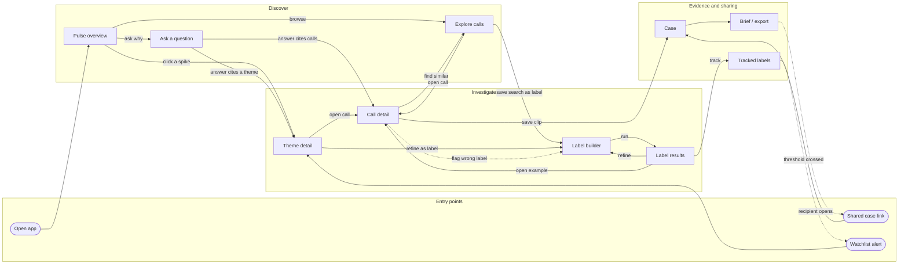
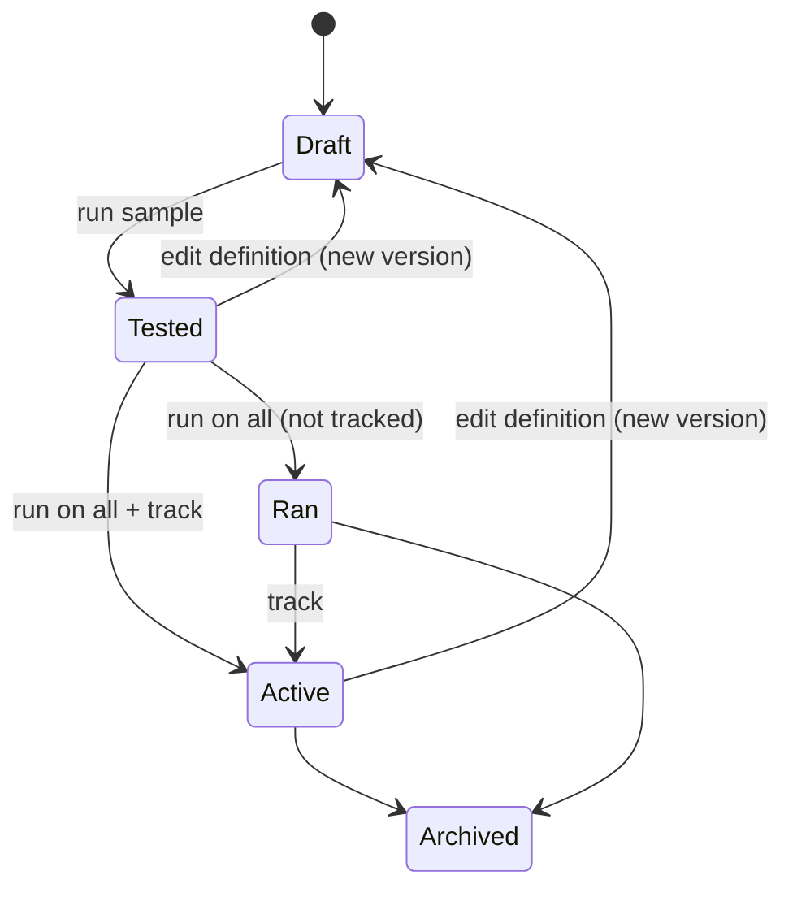
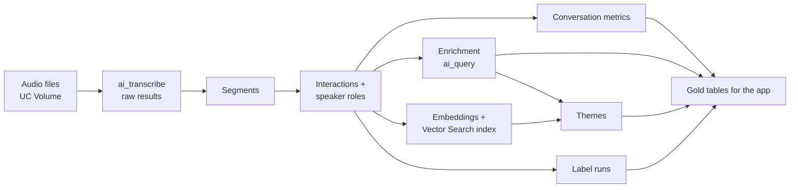
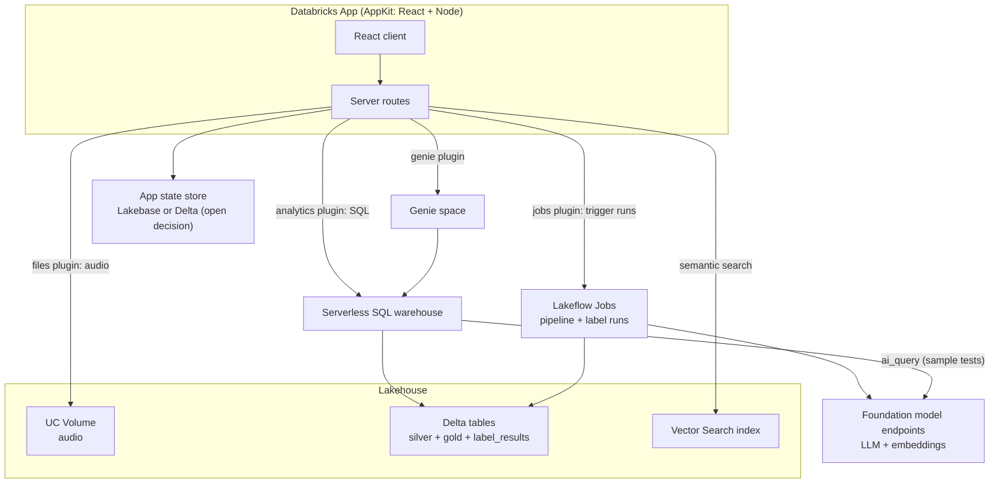

# Call Insights — Product and Technical Spec

**Status:** Draft v0.2, with repository layout updated 24 Oct 2026. The transcription pipeline has a documented full-corpus run. Enrichment code and a partial SQL-backed AppKit app are present; label execution and the complete app journeys remain to be built. See the [repository README](../README.md) for current component status and setup.
**Workspace:** `fevm-serverless-stable-prvwqx` (CLI profile of the same name)
**Catalog / schema:** `serverless_stable_prvwqx_catalog.call_insights`
**Wireframes:** [`call-insights-wireframes.html`](call-insights-wireframes.html) (open in a browser)

**New to this project?** Read §1–§4 for the product, §9–§10 for the pipeline and tables, then §19 for how to run things, the gotchas, and the next tasks.

---

## 1. Summary

Call Insights is a Databricks App that lets call center managers and process improvement analysts explore recorded conversations, find patterns, and build evidence for process changes. It sits on top of the existing `ai_transcribe` pipeline in this repo and adds three things:

1. **Enrichment** of each conversation: summary, contact reason, sentiment, key moments, and conversation metrics such as silence, overtalk and talk ratio.
2. **An analyst workspace** for browsing, asking questions, drilling from patterns down to individual moments in the audio, and saving evidence.
3. **Label building**: analysts describe a pattern in plain English, test it on a sample, run it across all conversations, and track it over time.

Label building is the main differentiator. It turns the app from a reporting dashboard into a tool for testing hypotheses.

## 2. Goals and non-goals

### Goals

- Cut the time from "I think X is happening" to "X happens in N% of calls, mostly in queue Y, here are three examples" from days of manual listening to minutes.
- Make every AI-generated claim checkable: every label, theme and summary links back to the transcript moment and the audio.
- Let non-technical users define and refine their own patterns without writing SQL or prompts in code.
- Run fully on Databricks, using Unity Catalog governance, serverless compute, and AI Functions.

### Non-goals (for MVP)

- Real-time or live-call analytics. Processing is batch.
- Agent-facing tooling (agent assist, live coaching).
- Replacing the workforce management or QA systems of record.
- Redacting audio. Transcript redaction is in scope; masking audio is not.
- Languages other than English and Spanish. This is a current `ai_transcribe` preview limit.

## 3. Users

| Persona | Primary question | Key journeys |
|---|---|---|
| Call center manager | How are my team and queues doing, and where should I step in? | Pulse check, theme drill-down |
| Process improvement analyst | Why does X happen, how often, and what does it cost? | Pattern investigation, label building, business case |
| QA / coaching lead (phase 2) | Is this agent following the process, and what should I coach? | Scorecards, flagged-moment review |
| Stakeholder (read-only) | What did the analyst find? | Opens a shared case or brief |

## 4. Key concepts

- **Interaction**: one complete conversation (a call). The unit everything is measured against.
- **Segment**: one speaker turn in an interaction, with start time, end time, speaker and text, as output by `ai_transcribe`.
- **Speaker role**: who a speaker is in the conversation (agent or customer for calls; participant for meetings). Derived after transcription.
- **Conversation metrics**: numbers calculated from segment timing alone: talk ratio, silence, overtalk, number of turns.
- **Enrichment**: AI-generated fields for each interaction: summary, contact reason, sentiment, resolution, key moments.
- **Theme**: an automatically discovered group of interactions about the same thing (for example "billing dispute: duplicate charge").
- **Label**: an analyst-defined pattern written in plain English, evaluated against each interaction. Returns matched or not, with an evidence quote and timestamp.
- **Label run**: one execution of a label version over a set of interactions (a sample test, a full run, or an incremental run on new data).
- **Tracked label**: a label that runs automatically on new interactions and appears as a metric over time.
- **Case**: a saved collection of clips, notes and findings that an analyst builds to support a recommendation.

## 5. User journeys

### MVP

1. **Pattern investigation (analyst).** Start from a question (Ask) or from filters (Explore). See the themes involved, drill into a theme, open representative calls, jump to the relevant moment, save clips to a case.
2. **Custom hypothesis test (analyst).** Write a label definition, test it on about 20 calls, review the matches, refine the wording, run it on everything, look at breakdowns, save it as tracked.
3. **Pulse check (manager), light version.** Headline metrics, a "what's changed" list, top contact reasons. Each item links into a theme or a label.
4. **Business case (analyst).** Turn a case into a brief with an impact estimate and audio clips, then share a link with stakeholders.

### Phase 2

5. **Quality review and coaching.** Score each agent against a rubric, review flagged moments, override AI scores, add coaching notes.
6. **Before and after a process change.** Mark the date a change went live, then compare a theme or label before and after.
7. **Alerts.** Get notified when a tracked label or theme crosses a threshold.

## 6. Flow map



Call detail is where every journey ends up, so it must always show why the user landed there and jump to the relevant moment.

## 7. Screens and functional requirements

Requirement IDs are for traceability. **M** = MVP, **P2** = phase 2.

Low-fidelity wireframes for Overview, Theme detail, Call detail and Label builder are in [`call-insights-wireframes.html`](call-insights-wireframes.html). They use made-up billing-dispute data from before the move to HarperValleyBank. Follow them for layout and interaction, not for content.

### 7.1 Global

| ID | Requirement | Phase |
|---|---|---|
| G-1 | Top navigation: Overview, Explore, Ask, Labels, Cases. | M |
| G-2 | Global filters for date range and queue, kept as the user moves between screens. | M |
| G-3 | Every AI-generated field shows a way to see its source (transcript segment or quote). | M |
| G-4 | Users only see interactions their Unity Catalog permissions allow (see §11). | M |
| G-5 | Deep links to an interaction at a timestamp, a theme, a label result, or a case. | M |

### 7.2 Pulse overview

| ID | Requirement | Phase |
|---|---|---|
| OV-1 | Headline metrics for the selected period, each with the change against the previous period: interaction count, average handle time, negative sentiment share, repeat contact rate. | M |
| OV-2 | "What's changed" list: themes and tracked labels whose volume or handle time moved beyond a threshold (§9.6). Each item links to the theme or label. | M |
| OV-3 | Top contact reasons by share of interactions. | M |
| OV-4 | Daily trend of volume and sentiment. | M |
| OV-5 | Ask box that hands the question to the Ask screen. | M |

### 7.3 Explore

| ID | Requirement | Phase |
|---|---|---|
| EX-1 | Interaction list with filters: date, queue, agent, contact reason, sentiment, theme, label match, duration, metric ranges (for example longest silence over 30s). | M |
| EX-2 | Keyword search over transcripts. | M |
| EX-3 | Semantic search ("calls about being charged twice"), backed by Vector Search. | M |
| EX-4 | "Find similar" from any interaction or segment. | M |
| EX-5 | "Save as label": turns the current search into a draft label definition. | M |

### 7.4 Ask

| ID | Requirement | Phase |
|---|---|---|
| AS-1 | Natural-language questions over the gold tables, backed by a Genie space. | M |
| AS-2 | Answers show the SQL used and the result table or chart. | M |
| AS-3 | When a result includes interaction or theme IDs, those rows link into Call detail or Theme detail. | M |
| AS-4 | Suggested starter questions on the empty state. | M |

### 7.5 Theme detail

| ID | Requirement | Phase |
|---|---|---|
| TH-1 | Theme name, AI summary of the theme, count, and change in volume. | M |
| TH-2 | Impact: average handle time compared with overall, repeat contact rate, estimated extra agent hours (§9.6). | M |
| TH-3 | Drivers within the theme (sub-themes) by share. | M |
| TH-4 | Breakdown by queue, and a daily trend. | M |
| TH-5 | Representative interactions (closest to the theme's centre), each with a quote. | M |
| TH-6 | Actions: refine as label (pre-fills a label definition from the theme summary), save to case. | M |

### 7.6 Call detail (hub)

| ID | Requirement | Phase |
|---|---|---|
| CD-1 | Header: interaction ID, date, duration, queue, agent. | M |
| CD-2 | "Why you're here" strip naming the theme, label or search that brought the user, and the timestamp jumped to. | M |
| CD-3 | Audio player with play/pause, seek, speed, and a timeline with one lane per speaker role. Holds and silences over the threshold are shown on the timeline. | M |
| CD-4 | Numbered key-moment markers on the timeline, matching a key moments list. Clicking a marker or list item seeks the audio. | M |
| CD-5 | Transcript with speaker turns and timestamps, highlighted in sync with playback. Clicking a turn seeks the audio. | M |
| CD-6 | Transcript search within the interaction. | M |
| CD-7 | Side panel: summary, tags (contact reason, themes, matched labels), conversation metrics. | M |
| CD-8 | Actions: save clip (start and end time, note) to a case; find similar; flag a wrong label or tag. | M |
| CD-9 | Personal identifiers in the transcript are masked by default (§11). | M |

### 7.7 Label builder and results

See §8 for the full behaviour.

| ID | Requirement | Phase |
|---|---|---|
| LB-1 | Create a label: name, plain-English definition, optional example quotes to include and exclude, scope (date range, queues). | M |
| LB-2 | Test on a sample (default 20 interactions), returning matches and a few non-matches for review. | M |
| LB-3 | Each result shows matched or not, confidence, evidence quote, timestamp and a one-line reason. | M |
| LB-4 | The reviewer marks each sampled result correct or incorrect. The app shows agreement (for example "18 of 20 correct"). | M |
| LB-5 | Editing the definition creates a new version. Results are always tied to a version. | M |
| LB-6 | Run on all interactions in scope, showing a cost and time estimate before starting. | M |
| LB-7 | Results view: share of interactions matched, breakdown by queue, agent and day, and example matches. | M |
| LB-8 | Track over time: the label runs automatically on new interactions and appears on the overview. | M |
| LB-9 | Labels library: list, search, owner, status, last run, agreement rate. | M |
| LB-10 | Output types beyond yes/no: category ("which reason did the customer give?") and score (1–5). | P2 |
| LB-11 | Threshold alerts on tracked labels. | P2 |

### 7.8 Cases and briefs

| ID | Requirement | Phase |
|---|---|---|
| CS-1 | Create a case; add clips, interactions, themes, label results and notes. | M |
| CS-2 | Impact block: pick a theme or label and get count, share, extra handle time and estimated agent hours. | M |
| CS-3 | Share a case with named users or groups (read-only). | M |
| CS-4 | Export a one-page brief (PDF or Markdown) with a link back into the app. | M |

### 7.9 Phase 2 screens

- **Agent scorecard:** rubric criteria (greeting, identity check, empathy, resolution, required disclosures) are each implemented as a label. Rubric score for each interaction, agent averages, flagged moments, reviewer override, coaching notes.
- **Before / after comparison:** pick a theme or label and a change date; compare share, handle time and sentiment before and after, with sample interactions from each period.

## 8. Label building in detail

### 8.1 Purpose

The predefined fields (contact reason, sentiment, themes) only cover what someone decided to model in advance. Process improvement usually starts with a specific hunch those fields don't cover, for example "customers are re-verified after transfers". Label building lets the analyst turn that hunch into a measurement, without a data team.

### 8.2 Lifecycle



- A full run requires at least one sample test on the same version (guardrail on cost and quality).
- Editing an active label creates a new version. The previous version stops tracking when the new one is activated. Trend charts mark where the version changed.

### 8.3 Definition

| Field | Notes |
|---|---|
| `name` | Short, shown everywhere. |
| `definition` | Plain English: what counts as a match. |
| `include_examples` | Optional quotes that should match. |
| `exclude_examples` | Optional quotes that look similar but should not match. |
| `scope` | Date range, queues, optional existing filter (for example "only billing dispute theme"). |
| `output_type` | `boolean` in MVP; `category` and `score` in phase 2. |
| `speaker_focus` | Optional: whose speech to consider (customer, agent, any). |

### 8.4 Evaluation

Each interaction is evaluated with a single `ai_query` call against a Databricks-hosted foundation model, using structured output.

Prompt template (illustrative):

```text
You are reviewing a customer service conversation transcript.

Definition of the pattern:
{definition}

Examples that SHOULD match: {include_examples}
Examples that should NOT match: {exclude_examples}
Only consider speech from: {speaker_focus}

Transcript (timestamp, speaker role, text):
{segments}

Return JSON:
{"matched": bool,
 "confidence": "low" | "medium" | "high",
 "evidence_quote": string | null,   // verbatim from transcript
 "evidence_start_seconds": number | null,
 "reason": string}                  // one sentence
```

SQL shape (illustrative; endpoint name to be confirmed in the workspace):

```sql
INSERT INTO label_results
SELECT
  :run_id, :label_id, :label_version, i.interaction_id,
  ai_query(
    :llm_endpoint,
    CONCAT(:prompt_prefix, i.transcript_with_timestamps, :prompt_suffix),
    responseFormat => :response_schema
  ) AS result,
  current_timestamp()
FROM interaction_transcripts i
WHERE i.interaction_id IN (SELECT interaction_id FROM label_run_scope WHERE run_id = :run_id)
```

### 8.5 Grounding check

The app does not trust the model's evidence quote blindly. After each run:

- The quote is fuzzy-matched against the interaction's segments. If found, `evidence_start_seconds` is replaced with the matching segment's start time.
- If the quote can't be found, the result is marked `ungrounded` and shown with a warning. Ungrounded rate is reported for each run.

### 8.6 Sample test

- Default 20 interactions drawn at random from the scope, stratified by queue.
- The sample shows matches first, then up to 5 non-matches, so reviewers can spot misses as well as false matches.
- Reviewer verdicts are stored as feedback for that version (§10).
- Agreement = correct verdicts ÷ reviewed results. Shown on the label and in the library.
- Runs synchronously through the SQL warehouse, with progress shown. Target under 60 seconds for 20 interactions.

### 8.7 Full and incremental runs

- A full run is submitted as a Lakeflow Job (triggered from the app through the Jobs plugin) so it survives the browser closing and can be retried.
- Before starting, the app shows the estimated number of interactions, tokens and cost, and roughly how long it will take.
- Tracked labels run incrementally on a schedule (default daily), processing only interactions not yet evaluated for that version.
- A per-run cap on interactions (configurable, default 100,000) and a per-user daily budget protect against runaway cost.

### 8.8 Feedback loop

- "Flag wrong label" in Call detail records a feedback row against the label version and interaction.
- The label page lists recent flags so the owner can refine the definition. Flagged quotes can be added to the include or exclude examples in one click.

## 9. Data pipeline

### 9.1 Overview



The target design runs these steps as tasks in one Lakeflow Job, scheduled daily and incremental on new audio; a pipeline deployment bundle is not implemented yet. The notebooks in `notebooks/harper_valley_bank/` implement steps A–E: **HarperValleyBank Data Loader** and **HarperValleyBank Transcription Pipeline**.

### 9.2 Transcription and speaker roles

**Channel alignment.** HarperValleyBank's agent and caller files don't always start together: in about 40% of calls the agent file starts roughly 2 seconds late. The loader works out each channel's offset from the reference transcript (conversation time − file time, which is constant within a call) and writes an aligned stereo file (agent left, customer right) whose timeline is the conversation timeline. That file is used for playback and as the source for transcription.

**Transcribe each speaker turn separately.** Speech is detected in each channel (20 ms frames, more than 15 dB above that channel's noise floor), nearby bursts are joined, and each burst is written as a short padded clip and transcribed. Role comes from the channel and timing from where the clip was cut. Consecutive clips from the same speaker less than 2s apart are joined into one turn. The exact thresholds are listed in §19.4. On a 20-call test (§18.5) this was the only approach that got both the words and the speakers right. On the full corpus it gives 10.0% WER and about 93% right speaker (§18.6):

| Approach | WER, whole call | WER, agent | WER, customer | Right speaker |
|---|---|---|---|---|
| Each channel file whole | — | 12.9% | 39.0% | — |
| Stereo file, roles by channel energy per segment | 11.4% | 23.9% | 37.5% | 84.8% |
| Each channel with silences removed | 43.0% | 8.8% | 9.5% | 47.5% |
| **Each speaker turn as its own clip** | **7.0%** | **8.8%** | **4.2%** | **93.5%** |
| Corpus's own ASR (Gridspace), for reference | 9.2% | 8.8% | 10.0% | — |

- Whole channel files fail because `ai_transcribe` drops most speech in a file that is mostly silence.
- The stereo file gets the words but diarization often puts agent and customer in one segment, and there are no word timings to split it.
- Removing silences makes `ai_transcribe` merge speech from either side of a gap, so times can't be mapped back.

**Transcription status.** Every clip gets a status in `interaction_transcription_status`: `ok`, `empty`, `no_speech` or `error`. About 12% of clips are breaths, clicks or noise, for which `ai_transcribe` returns "stage12 segmentation size 0". Re-padding and adding dither didn't rescue them, so they are recorded as `no_speech` and not retried. Other errors are retried once. Nothing is dropped silently.

**Speaker IDs.** `ai_transcribe` numbers speakers within each file, so its IDs are never used for identity. Agent and customer IDs come from call metadata.

**Mono recordings (future sources).** If a source only has mixed mono audio, transcribe the whole call and map speakers to roles with an `ai_query` classification over the first few turns ("which speaker is the agent?"). Expect role accuracy well below the channel approach.

### 9.3 Conversation metrics

Calculated in SQL from turn timing, plus overtalk measured from the audio:

| Metric | Definition |
|---|---|
| `duration_seconds` | Last turn end − first turn start. This is shorter than `interactions.duration_seconds`, which is the length of the stereo audio file. |
| `talk_seconds_<role>` | Sum of turn durations per role. |
| `talk_ratio_agent` | Agent talk ÷ total talk. |
| `silence_seconds_total` | Sum of gaps longer than 2s. A gap is measured from the latest end of any earlier turn, so overlapping turns don't create negative gaps. |
| `longest_silence_seconds` | Longest gap, measured the same way. |
| `hold_count` | Gaps longer than 30s (hard-coded in the SQL for now). |
| `overtalk_count`, `overtalk_seconds` | Periods of at least 0.5s when both channels have speech, from the same speech detection used to cut clips. |
| `agent_active_seconds`, `customer_active_seconds` | Speech time per channel from the audio. |
| `turn_count` | Number of speaker changes. |
| `segment_count` | Number of turns. |

### 9.4 Enrichment

One `ai_query` call per interaction with structured output:

- `summary` (2–3 sentences)
- `contact_reason` (from a configurable list, plus "other")
- `sentiment_start`, `sentiment_end` (negative, neutral, positive)
- `resolution_status` (resolved, unresolved, transferred, unclear)
- `repeat_contact_mentioned` (bool)
- `transfer_count`
- `key_moments`: array of `{label, start_seconds, quote}`, maximum 6
- `topic_phrase`: short phrase used as input to theme discovery

Key moment quotes go through the same grounding check as labels (§8.5).

### 9.5 Themes

Proposed approach (to validate in the notebook prototype):

1. Embed each interaction's `topic_phrase` plus summary using a Databricks-hosted embedding model.
2. Cluster weekly (for example HDBSCAN or k-means over embeddings) within each contact reason.
3. Name each cluster and write a theme summary with `ai_query` over its most central interactions.
4. Match new clusters to existing themes by centroid similarity so theme IDs stay stable across weeks.
5. Sub-themes ("drivers") are clusters within a theme.

### 9.6 Derived business metrics

- **Average handle time** = mean `duration_seconds`. This is a proxy until real handle time (including after-call work) comes from the telephony system.
- **Repeat contact rate** = share of interactions from the same customer within 48 hours, where a customer ID is available. Otherwise use `repeat_contact_mentioned`.
- **Extra agent hours** for a theme or label = (its average handle time − overall average handle time) × its interaction count ÷ 3600. Always labelled as an estimate.
- **"What's changed" detection** = the last 7 days compared with the previous 4-week weekly average. Flag when the change exceeds ±25% **and** weekly volume is at least 50 interactions. Both thresholds are configurable.

## 10. Data model

Schema: `serverless_stable_prvwqx_catalog.call_insights` (created). Volume `hvb_raw` holds:

- `audio/agent/<sid>.wav` and `audio/caller/<sid>.wav`: the original 8 kHz mono channel files.
- `audio/stereo/<sid>.wav`: the aligned stereo file (agent left, customer right). This is the playback file, and `interactions.audio_path` points to it.
- `audio/chunks/<chunk_id>.wav`: one padded clip per speech burst. These are only used for transcription and are about 22,500 files.
- `metadata/<sid>.json` and `transcript/<sid>.json`: the original corpus files.

The AMI tables in `audio_parsing` belong to the independent AMI example and are not consumed by Call Insights. Bronze and silver tables are built by the `notebooks/harper_valley_bank/` notebooks. Gold and app-state tables other than `interaction_metrics` don't exist yet. §10.1–§10.2 list the real columns as of 22 Oct 2026.

### 10.1 Bronze: HarperValleyBank

| Table | Contents |
|---|---|
| `hvb_calls` | One row per call: `sid`, `session`, `call_start_ts`, `call_end_ts`, `call_duration_seconds`, `task_type` (intent), `task_slots_json`, `agent_speaker_id`, `agent_name`, `caller_speaker_id`, `caller_name`, `script_adherence_score`, `agent_mos`, `caller_mos`, `agent_offset_seconds`, `caller_offset_seconds`, `offset_source`, `offset_spread_ms`, `sample_rate_hz`, `agent_audio_seconds`, `caller_audio_seconds`, `stereo_audio_seconds`, `agent_audio_path`, `caller_audio_path`, `stereo_audio_path`. |
| `hvb_reference_utterances` | One row per human reference utterance: `sid`, `utterance_index`, `speaker_role` (`agent` or `caller`), `channel_index`, `conversation_start_seconds`, `channel_start_seconds`, `duration_seconds`, `human_transcript`, `gridspace_transcript`, `dialog_acts`, `emotion_negative`, `emotion_neutral`, `emotion_positive`. Ground truth for evaluation only; never shown in the app. Utterances whose text starts with `[` (noise tags) are excluded from evaluation. |
| `hvb_speech_chunks` | One row per speech clip: `chunk_id`, `sid`, `speaker_role`, `chunk_index`, `speech_start_seconds`, `speech_end_seconds`, `clip_offset_seconds` (add to a time in the clip to get call time), `clip_seconds`, `chunk_path`. |
| `hvb_transcriptions_raw` | `chunk_id`, `sid`, `audio_path`, `result` (`ai_transcribe` output as a variant), `attempt`, `transcribed_at`. |
| `hvb_transcription_eval` | `sid`, `speaker_role` (`agent`, `customer` or `all`), `reference_words`, `errors_ai_transcribe`, `errors_gridspace`, `wer_ai_transcribe`, `wer_gridspace`. |

### 10.2 Silver: interactions

| Table | Key columns |
|---|---|
| `interactions` | `interaction_id` (= `sid`), `source` (harper_valley_bank, synthetic), `started_at`, `duration_seconds`, `queue`, `agent_id`, `agent_name`, `customer_id`, `language`, `audio_path`, `audio_offset_seconds` (always 0 because the stereo file is already aligned; currently typed DECIMAL, should be DOUBLE), `transcription_status`: `pending` if there are no clip results, `failed` if no clip is `ok`, `partial` if any clip is `error`, otherwise `ok` |
| `interaction_segments` | One row per speaker turn: `interaction_id`, `segment_idx` (starts at 1, in time order), `start_seconds`, `end_seconds` (on the stereo audio timeline), `speaker_id` (from metadata), `speaker_role` (`agent` or `customer`), `text`, `clip_count`; `text_masked` to add with enrichment |
| `interaction_transcripts` | `interaction_id`, `transcript_with_timestamps` (one `[mm:ss] Agent: text` line per turn, ready for prompts), `segment_count`; `transcript_masked` to add with enrichment |
| `interaction_transcription_status` | `audio_path`, `interaction_id`, `chunk_id`, `speaker_role`, `status` (ok, empty, no_speech, error), `error_message`, `input_duration_seconds`, `attempt`, `transcribed_at` |
| `interaction_audio_features` | `interaction_id`, `agent_active_seconds`, `customer_active_seconds`, `overtalk_count`, `overtalk_seconds` |

### 10.3 Gold: analytics

| Table | Key columns |
|---|---|
| `interaction_metrics` (built) | `interaction_id` + metrics from §9.3 |
| `interaction_enrichment` | `interaction_id`, fields from §9.4, `model_endpoint`, `prompt_version`, `processed_at` |
| `interaction_embeddings` | `interaction_id`, `embedding`; source for the Vector Search index |
| `themes` | `theme_id`, `parent_theme_id`, `name`, `summary`, `first_seen`, `status` |
| `theme_membership` | `theme_id`, `interaction_id`, `distance`, `is_representative` |
| `daily_stats` | `date`, `queue`, `dimension_type` (overall, theme, label, contact_reason), `dimension_id`, `interaction_count`, `avg_duration`, `negative_share`, `repeat_share` |

### 10.4 App state

| Table | Key columns |
|---|---|
| `labels` | `label_id`, `name`, `owner`, `status`, `current_version`, `tracked`, `created_at` |
| `label_versions` | `label_id`, `version`, `definition`, `include_examples`, `exclude_examples`, `scope`, `output_type`, `speaker_focus`, `prompt_hash`, `created_by`, `created_at` |
| `label_runs` | `run_id`, `label_id`, `version`, `run_type` (sample, full, incremental), `status`, `interactions_in_scope`, `interactions_matched`, `ungrounded_count`, `estimated_tokens`, `job_run_id`, `started_at`, `finished_at` |
| `label_results` | `run_id`, `label_id`, `version`, `interaction_id`, `matched`, `confidence`, `evidence_quote`, `evidence_start_seconds`, `grounded`, `reason`, `processed_at` |
| `label_feedback` | `label_id`, `version`, `interaction_id`, `reviewer`, `verdict`, `note`, `source` (sample review, call detail flag), `created_at` |
| `cases` | `case_id`, `title`, `owner`, `shared_with`, `created_at`, `updated_at` |
| `case_items` | `case_id`, `item_type` (clip, interaction, theme, label, note), `ref_id`, `start_seconds`, `end_seconds`, `note`, `position` |
| `annotations` | `interaction_id`, `start_seconds`, `author`, `text`, `created_at` |

`label_results` is large and written in batch, so it stays in Delta. The other app-state tables are small and written interactively by users. Where they live is an open decision (§14).

## 11. Architecture

### 11.1 Components



### 11.2 Technology choices

| Concern | Choice | Notes |
|---|---|---|
| App framework | AppKit (TypeScript, React) | Recommended Databricks Apps framework; typed SQL queries. |
| Reads for dashboards and lists | AppKit analytics plugin over a serverless SQL warehouse | Queries in `config/queries/*.sql`. |
| Ask | AppKit Genie plugin over a Genie space on the gold tables | |
| Audio playback | AppKit files plugin reading from the UC Volume | Needs seeking (HTTP range requests) for jump-to-moment; verify. |
| Semantic search | Vector Search index on `interaction_embeddings` | |
| Label sample tests | `ai_query` through the SQL warehouse | Synchronous, small. |
| Full and incremental label runs, pipeline | Lakeflow Jobs, deployed with Declarative Automation Bundles | Triggered from the app through the jobs plugin. |
| App state | Lakebase (Postgres) **or** Delta through the warehouse | See §14. |
| Deployment | Declarative Automation Bundle containing app, jobs, Genie space and permissions | One bundle, dev and prod targets. |

### 11.3 Performance targets

| Interaction | Target |
|---|---|
| Overview, Theme detail, Explore list load | Under 3s at p90 |
| Call detail load (transcript + metadata) | Under 2s at p90 |
| Audio starts playing after seek | Under 1s |
| Label sample test (20 interactions) | Under 60s |
| Full label run, 50,000 interactions | Under 30 min |

## 12. Data strategy

**Decision: build on the HarperValleyBank corpus, then add synthetic problem calls for the demo.**

### 12.1 Primary source: HarperValleyBank

[HarperValleyBank](https://github.com/cricketclub/gridspace-stanford-harper-valley) (Gridspace and Stanford, 2020; [paper](https://arxiv.org/abs/2010.13929)) is a corpus of role-played consumer banking phone calls between two people, one acting as the agent and one as the customer.

| Property | Value |
|---|---|
| Size | 1,446 calls, 23.7 hours, 59 speakers; about 2.6 GB of audio |
| Audio | 8 kHz, 16-bit mono WAV, **one file per side** (agent and caller), recorded over real phones |
| Licence | CC BY 4.0: commercial use allowed with attribution |
| Ground truth | Human transcript per utterance with timing; caller intent (8 classes); dialog acts (16 classes, model-generated); emotion scores per utterance (model-generated); agent and caller speaker IDs and names; script adherence and audio quality scores per call |
| Intents | order checks, check balance, replace card, reset password, get branch hours, pay bill, schedule appointment, transfer money |

**Why it fits:** it is genuine call center audio that the audience will recognise. Separate agent and caller recordings make speaker roles certain. The ground truth lets the pipeline, enrichment and label engine be measured rather than eyeballed. For example, a label for "caller wants to move money between accounts" can be scored for precision and recall against the `transfer money` intent.

**Limitations:**
- Calls are scripted, short (about a minute) and simple (about 735 unique words), and calls that went wrong were filtered out. There are essentially no holds, transfers, escalations, repeat contacts or frustrated customers, so most problem-finding labels will rarely match.
- Calls come from three recording sessions in June 2020, so there is no useful spread over time.
- There are no queues; they are derived from intent (§12.3).

### 12.2 Demo augmentation (M3)

1. **Spread over time.** Reassign `started_at` across a few months with realistic daily and weekly volume patterns, so trends and "what's changed" have something to show. The original timestamp is kept in `hvb_calls`.
2. **Planted problem calls.** Generate a few hundred synthetic calls in the same style containing known patterns: duplicate charges, re-verification after a transfer, long holds, a repeat caller. Use LLM-written two-person scripts and two-voice text-to-speech, rendered as separate agent and caller channels at 8 kHz so they go through the same pipeline. Introduce them from a chosen date to create a visible spike. Each planted pattern has a known answer for measuring label accuracy.
3. Mark every synthetic or modified row with `source = 'synthetic'` or a `demo_adjusted` flag so evaluation can exclude it.

### 12.3 Mapping to the schema

| Schema field | HarperValleyBank source |
|---|---|
| `interaction_id` | `sid` |
| `queue` | Derived from intent: Cards and checks (replace card, order checks), Payments (pay bill, transfer money), Account access (check balance, reset password), General enquiries (branch hours, schedule appointment) |
| `agent_id`, `agent_name` | Agent `speaker_id` and name from metadata |
| `customer_id` | Caller `speaker_id`. Workers swapped roles between calls, so the same person can appear as both agent and customer. |
| `speaker_role` | `agent` or `customer`, from the audio channel |
| `contact_reason` (evaluation only) | `task_type` |

### 12.4 Options considered

| Option | Outcome |
|---|---|
| AMI Meeting Corpus clips (current `audio_parsing` data) | Ruled out: sparse, very short clips from one meeting; meeting content, not calls (§18.1). |
| AMI full mixed-headset meeting recordings | Not needed: HarperValleyBank is call audio with better ground truth. |
| Fully synthetic call audio | Used only to add problem patterns on top of HarperValleyBank (§12.2). |
| Real customer recordings | Out of scope until there is a customer engagement with data agreements and PII handling. |

The schema stays domain-neutral (`interaction`, `speaker_role`, `queue`), so changing source only changes the loader.

## 13. Security, privacy and governance

- **Access:** the app uses on-behalf-of-user authorization for SQL so Unity Catalog permissions apply per user. Row filters on `interactions` by queue let managers see only their queues.
- **PII in transcripts:** `text_masked` and `transcript_masked` are produced with `ai_mask` (account numbers, card numbers, phone numbers, email addresses, names). The app shows masked text by default; unmasked text needs a separate permission.
- **PII in prompts:** label and enrichment runs use masked transcripts unless a label explicitly needs the raw text (for example detecting identity checks), which requires elevated permission.
- **Audio:** cannot be masked in MVP. Access to the volume is restricted to the app's service principal and an approved group.
- **Audit:** label creation, full runs, case sharing and unmasking are logged to an audit table.
- **Retention:** follows the source system's recording retention policy; deleting an interaction cascades to all derived tables.

## 14. Open decisions

| # | Decision | Options | Recommendation |
|---|---|---|---|
| 1 | Data source for build and demo | **Decided (§12):** HarperValleyBank, plus synthetic problem calls for the demo | — |
| 2 | App state store | Lakebase (fast interactive writes, needs a new project) vs Delta through the SQL warehouse (simpler, slower writes) | Lakebase if cases and annotations are in MVP; otherwise Delta |
| 3 | LLM endpoint for enrichment and labels | See §18.3 for candidates | Stronger model for labels, cheaper model for bulk enrichment; confirm on 50 interactions |
| 4 | Theme discovery method | Embedding clustering vs LLM topic extraction plus normalisation | Prototype both on HarperValleyBank and check how well themes recover the 8 intents; choose on accuracy and stability week to week |
| 5 | Sample test execution | SQL warehouse `ai_query` vs calling the serving endpoint directly from the app server | SQL warehouse (one governed path) |
| 6 | Agent and customer role mapping | **Decided (§9.2):** separate channels, each speaker turn transcribed as its own clip; LLM classification only for mono sources | — |
| 7 | Brief export format | PDF vs Markdown vs Google Doc | Markdown + PDF |
| 8 | Text-to-speech for planted synthetic calls (§12.2) | Not researched yet | Needs two distinct voices, rendered as separate 8 kHz channels |
| 9 | Contact reason list for enrichment (§9.4) | The 8 HarperValleyBank intents plus "other" vs a broader generic list | The 8 intents plus "other" for now, so accuracy can be scored against `task_type` |

## 15. Milestones

| Milestone | Scope | Exit criteria |
|---|---|---|
| M0. Data foundation | Loader for chosen source; interactions, segments, metrics; enrichment on all interactions. **Loader, transcription, interactions, segments and metrics are done and run on the full corpus of 1,446 calls (§18.6); still to do: enrichment, PII masking, the hand check of metrics on 10 interactions, and wrapping the notebooks in a bundle job (§19.6).** | Gold tables populated; metrics checked by hand on 10 interactions; WER and speaker accuracy reported against the reference. |
| M1. Label engine prototype (notebook) | Label versions, sample and full runs, grounding check, feedback table. Three sample labels. | At least 85% reviewer agreement on samples for 2 of 3 labels; ungrounded rate under 5%. |
| M2. App MVP: investigate | AppKit app with Explore, Call detail (audio + transcript sync), Label builder and results. | An analyst can go from label idea to full results to a specific moment in audio without help. |
| M3. App MVP: discover and share | Overview, Themes, Ask (Genie), Cases and brief export, tracked labels. | End-to-end walkthrough of journeys 1–4 with a pilot user. |
| P2 | Scorecards, before/after, alerts, category and score labels. | — |

## 16. Success measures

- **Time to insight:** a pilot analyst can answer a new "how often does X happen" question in under 15 minutes.
- **Label quality:** median reviewer agreement on active labels of at least 85%.
- **Trust:** at least 90% of evidence quotes grounded; fewer than 1 in 20 label results flagged as wrong in Call detail.
- **Adoption:** number of labels created and tracked per analyst per month; number of cases shared.
- **Cost:** AI Functions cost per 1,000 interactions processed, tracked per run.

## 17. Risks

| Risk | Impact | Mitigation |
|---|---|---|
| HarperValleyBank calls are too clean | Labels and themes find little to show | Planted synthetic problem calls (§12.2) |
| `ai_transcribe` is in preview | Behaviour or limits may change; English and Spanish only | Isolate in the bronze step; keep raw results; re-run the WER check (§18.5) after any change |
| Clip-per-turn approach costs more calls | About 15.6 clips per call (22,501 for the full corpus) and at least 2s billed per clip because of padding | Look up the actual cost of the 22 Oct run in `system.billing.usage` (not checked yet); tune speech detection to merge more bursts if needed |
| Short clips produce stray words | A one-word clip at the end of a call can come back as a stray turn (for example a final "Customer: Hi") | Consider dropping `ok` clips under about 0.4s of speech whose text is a single word; measure the WER effect first |
| Speaker role errors | Wrong roles break talk ratio and agent/customer labels | Roles from channels (about 93% match on the full corpus); manual role swap in Call detail |
| LLM labels drift or mislead | Users lose trust | Versioning, sample review, grounding check, visible agreement rate |
| Label run cost on large volumes | Unexpected spend | Mandatory sample test, cost estimate, per-run cap, per-user budget |
| Audio seeking from UC Volume is slow | Jump-to-moment feels broken | Verify range requests early in M2; fall back to pre-cut clips around key moments |
| PII exposure | Compliance issue | Masking by default, row filters, audit log |

## 18. Workspace findings

Checked against `fevm-serverless-stable-prvwqx` on 22 Oct 2026.

### 18.1 Existing data

| Item | Finding |
|---|---|
| Tables | `ami_meeting_audio`, `ami_transcriptions_raw`, `ami_transcriptions` in `audio_parsing`, built by the AMI example notebooks, now in `notebooks/ami/`. AMI remains an independent example; these tables are not inputs to Call Insights. |
| Volume | 20 WAV files in `audio_parsing.ami_audio`. |
| Coverage | 20 clips from **one meeting** (`EN2002a`), four speakers. Clips are 0.14–4.5s long, about 25s of audio in total, scattered across roughly 31 minutes of the meeting. |
| Transcription results | 11 clips produced segments. 2 returned no segments (both near-silent or one-word). 7 failed: 6 with "An unknown error occurred." and 1 with a segmentation error. Every failed clip is under about 1.3s. |
| Segments | 12 rows in `ami_transcriptions`. |
| Speaker IDs | `ai_transcribe` numbers speakers **within each file** ("1", "2"), so the same ID in two files is not the same person. One 1.5s clip was split into two speakers. |

### 18.2 What this changes in the spec

- **The AMI clips are ruled out as a source.** Twenty sparse clips from one meeting can't be rebuilt into a conversation. The build moved to HarperValleyBank (§12).
- **Speaker identity (§9.2).** Speaker IDs from `ai_transcribe` are only meaningful within one file. Role mapping must always run per interaction, and any cross-interaction identity (agent ID, customer ID) has to come from metadata, never from `speaker_id`.
- **Transcription errors must be captured.** The existing notebook filters on `result:response IS NOT NULL`, but failed rows carry an `error_message` with a null variant response, so failures are dropped silently. The pipeline now writes a status (`ok`, `empty`, `no_speech`, `error`) and the error message for each clip to `interaction_transcription_status`, reports counts per run, and retries real errors once.
- **Minimum audio length.** Very short clips fail or return nothing. The HarperValleyBank pipeline pads every clip to at least 2s with 0.5s of leading silence, which removed the "unknown error" failures (0 errors on 22,501 clips).

### 18.3 Platform

| Item | Finding | Spec impact |
|---|---|---|
| SQL warehouse | `Serverless Starter Warehouse` (`8d4699c5c6d30f71`), Small, currently stopped (starts on demand). | Use for the app's analytics plugin. Size up or use a dedicated warehouse if sample tests run slowly. |
| LLM endpoints | Many Databricks-hosted chat models are ready, including `databricks-claude-sonnet-5-5`, `databricks-claude-haiku-5-5`, `databricks-gpt-5-4-mini` and `databricks-gemini-3-8-flash`. | Decision 3 candidates: a stronger model (`databricks-claude-sonnet-5-5`) for label evaluation, where accuracy matters most, and a cheaper one (`databricks-claude-haiku-5-5` or `databricks-gpt-5-4-mini`) for bulk enrichment. Compare on 50 interactions. |
| Embedding endpoints | `databricks-gte-large-en`, `databricks-bge-large-en`, `databricks-qwen3-embedding-0-6b`. | Default to `databricks-gte-large-en` for themes and semantic search. |
| Lakebase | API available; no projects exist. | Decision 2: choosing Lakebase means creating a new project. |
| Genie | No spaces exist. | Create a new space over the gold tables in M3. |
| Apps | No apps deployed. | Clean start. |

### 18.4 Still open

- Whether the AppKit files plugin supports seeking (HTTP range requests) within audio files in a UC Volume. Test this first in M2; the fallback is pre-cut clips around key moments.
- Throughput limits on the chosen LLM endpoint for full label runs of 50,000 interactions.

### 18.5 HarperValleyBank test load (20 calls)

Run on 22 Oct 2026 with the two `notebooks/harper_valley_bank/` notebooks as serverless jobs.

| Item | Result |
|---|---|
| Loaded | 20 calls (0.31 hours of stereo audio), 353 reference utterances, 80 source files, no failures. Download and load took under a minute. |
| Channel offsets | 8 of 20 calls have the agent file starting 2.0–2.2s late; the rest are aligned. Offsets are constant within each call (spread ≤ 1 ms). |
| Clips | 310 clips (about 15 per call): 257 `ok`, 32 `no_speech`, 21 `empty`, 0 `error`. Transcription took 40s. All 20 calls `ok`. |
| Coverage | 97.9% of customer and 97.8% of agent reference utterances overlap a transcribed turn. |
| Speaker roles | Right speaker for 92.1% of customer and 94.9% of agent reference utterances. |
| Word error rate | 7.0% whole call (agent 8.8%, customer 4.2%), against 9.2% for the corpus's own ASR. Slightly overstated because the reference spells out numbers. |
| Metrics | Average agent talk ratio 0.55, longest silence 4.4s on average, about 9 speaker changes per call, no holds, 1 overtalk event in 20 calls, as expected for scripted calls. |

### 18.6 HarperValleyBank full corpus (1,446 calls)

Run on 22 Oct 2026 as one serverless job: the loader with `max_calls = all`, then the pipeline. The pipeline was incremental, so the 20 calls from §18.5 were skipped.

| Item | Result |
|---|---|
| Loaded | 1,446 calls (23.96 hours of stereo audio), 25,730 reference utterances, 5,784 source files, no failures. The loader took 10.6 minutes. |
| Channel offsets | The median agent offset is 2.01s and the median customer offset is 0s. Offsets are constant within each call (spread ≤ 1 ms). No call needed the default offset. |
| Clips | 22,501 clips (about 15.6 per call). Of the 22,191 new clips: 18,880 `ok`, 2,716 `no_speech` (12%), 905 `empty`, 0 `error`. The pipeline took 40 minutes, of which `ai_transcribe` took 26 minutes (about 14 clips/s). All 1,446 calls are `ok`. |
| Coverage | 98.4% of customer and 97.9% of agent reference utterances overlap a transcribed turn, so the `no_speech` clips are mostly noise, not missed speech. |
| Speaker roles | Right speaker for 93.0% of customer and 93.8% of agent reference utterances. |
| Word error rate | 10.0% whole call (agent 10.2%, customer 14.5%), against 9.4% for the corpus's own ASR (agent 8.1%, customer 11.7%). The per-role rates are higher than the whole-call rate because words given to the wrong speaker count against both roles. The 20-call sample in §18.5 was optimistic. |
| Metrics | Average agent talk ratio 0.56, longest silence 4.9s on average, 8.9 speaker changes per call, 1 hold, 172 overtalk events across the corpus. |

Job run: `1018778137760110` (task runs: loader `110994671455996`, pipeline `1087976660559579`).

## 19. Implementation guide

Practical notes for whoever picks this up next, whether a person or an agent.

### 19.1 Repo layout

| Path | Contents |
|---|---|
| `docs/call-insights-spec.md` | This spec. |
| `docs/call-insights-wireframes.html` | Low-fidelity wireframes (§7). |
| `notebooks/harper_valley_bank/HarperValleyBank Data Loader.py` | Downloads the corpus, aligns channels, writes stereo audio, builds `hvb_calls` and `hvb_reference_utterances`. Widget `max_calls` takes a number or `all` (default 200). |
| `notebooks/harper_valley_bank/HarperValleyBank Transcription Pipeline.py` | Cuts speech clips, runs `ai_transcribe`, builds the silver tables and `interaction_metrics`, and runs the evaluation. No widgets. |
| `notebooks/ami/` | Independent AMI meeting transcription and scale-testing example. |
| `notebooks/harper_valley_bank/HarperValleyBank Enrichment.py` | Masking, model comparison and enrichment for the call data. |
| `apps/call-insights/` | Standalone AppKit app, including its dependencies and deployment bundle. |
| `models/transcription/` | Qwen3-ASR MLflow wrapper, UC registration, explicit-version deployment, query client, MLflow accuracy/latency/concurrency comparison notebook and local tests. Real A10G packaging, UC version 2 deployment on matching GPU packages, endpoint contract checks and companion serverless notebooks passed, including a four-crop live comparison. Representative benchmark runs and integration into the main transcription notebooks remain pending; see its README. |
| `prototypes/call-insights/` | Mock React UX reference with in-memory state. |

The notebooks are Databricks source-format `.py` files. The local copies are the source of truth, and the workspace copies at `/Workspace/Users/brian.law@databricks.com/db_transcribe_scaling/harper_valley_bank/` are imported from them. These workspace paths record the existing imports; reorganizing local folders does not move them. The local paths above reflect the 24 Oct 2026 reorganization. The app consumes persisted tables and deploys independently of the notebook examples.

### 19.2 Environment

| Item | Value |
|---|---|
| CLI profile | `fevm-serverless-stable-prvwqx`. Always pass `--profile`. `databricks auth profiles` may show it as not valid while commands still work. If a command fails with an auth error, ask the user to run `databricks auth login --profile fevm-serverless-stable-prvwqx`. |
| SQL warehouse | `8d4699c5c6d30f71` (Serverless Starter Warehouse, Small). Starts on demand. |
| Compute for notebooks | Serverless jobs, environment client `4`. `pandas`, `numpy` and `requests` are available. There is no classic cluster. |
| Catalog, schema, volume | `serverless_stable_prvwqx_catalog.call_insights`, volume `hvb_raw` at `/Volumes/serverless_stable_prvwqx_catalog/call_insights/hvb_raw`. |
| Outbound internet | Needed by the loader: `api.github.com` (one unauthenticated tree request per run) and `codeload.github.com` (about 650 MB tarball). |

Ad hoc SQL from a terminal:

```bash
databricks experimental aitools tools query --profile fevm-serverless-stable-prvwqx \
  --warehouse 8d4699c5c6d30f71 "SELECT status, COUNT(*) FROM serverless_stable_prvwqx_catalog.call_insights.interaction_transcription_status GROUP BY ALL"
```

### 19.3 Running the notebooks

1. Import the local files:

```bash
D=/Workspace/Users/brian.law@databricks.com/db_transcribe_scaling/harper_valley_bank
databricks workspace import "$D/HarperValleyBank Transcription Pipeline" \
  --file "notebooks/harper_valley_bank/HarperValleyBank Transcription Pipeline.py" \
  --format SOURCE --language PYTHON --overwrite --profile fevm-serverless-stable-prvwqx
```

2. Submit a one-off serverless run. This is the JSON used for the full-corpus run; drop the loader task to rerun only the pipeline:

```json
{
  "run_name": "hvb-full-corpus",
  "tasks": [
    {"task_key": "loader",
     "notebook_task": {"notebook_path": "<D>/HarperValleyBank Data Loader", "base_parameters": {"max_calls": "all"}},
     "environment_key": "default"},
    {"task_key": "pipeline", "depends_on": [{"task_key": "loader"}],
     "notebook_task": {"notebook_path": "<D>/HarperValleyBank Transcription Pipeline"},
     "environment_key": "default"}
  ],
  "environments": [{"environment_key": "default", "spec": {"client": "4"}}]
}
```

```bash
databricks jobs submit --no-wait --json @submit.json --profile fevm-serverless-stable-prvwqx
databricks jobs get-run <run_id> --profile fevm-serverless-stable-prvwqx          # poll state; tasks[].run_id
databricks jobs get-run-output <task_run_id> --profile fevm-serverless-stable-prvwqx  # notebook_output.result
```

3. Each notebook ends with `dbutils.notebook.exit(json)`. The JSON summary (counts, timings, WER, coverage, an example transcript) is the quickest way to check a run without opening the notebook.

Expected runtimes for the full corpus: loader about 11 minutes; pipeline about 40 minutes from scratch, of which `ai_transcribe` is about 26 minutes. A pipeline rerun with no new calls only rebuilds the silver tables and the evaluation, which takes a few minutes.

### 19.4 Pipeline behaviour

**What is incremental.** `hvb_speech_chunks` and `interaction_audio_features` are appended to only for calls not yet in `interaction_audio_features`. `hvb_transcriptions_raw` is appended to only for clips not yet in it. Everything after that (`interaction_transcription_status`, `interactions`, `interaction_segments`, `interaction_transcripts`, `interaction_metrics`, `hvb_transcription_eval`) is rebuilt with `CREATE OR REPLACE` on every run.

**What the loader overwrites.** The loader rewrites the selected calls' files and overwrites `hvb_calls` and `hvb_reference_utterances` on every run. It does not touch clips or transcriptions.

**Forcing a re-cut or re-transcription.** If you change the speech detection constants, the clip format or the stereo files, existing calls are not reprocessed. Drop `hvb_speech_chunks`, `interaction_audio_features` and `hvb_transcriptions_raw`, delete `audio/chunks/`, then rerun the pipeline. That costs another full `ai_transcribe` pass, about 22,500 clips. Tables use `CREATE TABLE IF NOT EXISTS`, so schema changes to the bronze tables also need a drop.

**Tuning constants** (top of the pipeline notebook):

| Constant | Value | Meaning |
|---|---|---|
| `FRAME_SECONDS` | 0.02 | Frame size for speech detection. |
| `ACTIVE_ABOVE_FLOOR` | 15.0 dB | A frame is speech if it's this far above the channel's noise floor (10th percentile of frame energy). |
| `MIN_ACTIVE_DBFS` | −50 dBFS | Frames quieter than this are never speech. |
| `MERGE_GAP_SECONDS` | 0.6 | Bursts closer than this are joined. |
| `MIN_SPEECH_SECONDS` | 0.15 | Shorter bursts are dropped. |
| `EDGE_PAD_SECONDS` | 0.25 | Audio kept either side of a burst. |
| `CLIP_LEAD_SECONDS` | 0.5 | Silence added before the speech in each clip. |
| `CLIP_MIN_SECONDS` | 2.0 | Clips are padded with trailing silence to at least this length. |
| `TURN_GAP_SECONDS` | 2.0 | Same-speaker clips closer than this become one turn. This value is also hard-coded in the step 7 SQL. |
| `MIN_OVERTALK_SECONDS` | 0.5 | Minimum length of one overtalk event. |

**Evaluation.** Step 10 checks coverage and speaker roles: each reference utterance is matched to the turn it overlaps most. Step 11 computes WER with a word-level edit distance after lowercasing and removing punctuation and `[noise]` tags. The reference spells numbers out ("one thirty p m"), while `ai_transcribe` writes digits, so WER on number-heavy calls is overstated. Rerun both after any change to transcription.

### 19.5 `ai_transcribe` notes

- It takes binary audio content: `ai_transcribe(content)` over `READ_FILES('<dir>/', format => 'binaryFile')`. In preview, English and Spanish only.
- Output is a variant. Use `result:response.segments` (array of `start`, `end`, `speaker_id`, `text`), `result:error_message`, and `result:metadata.input_duration_seconds`.
- Errored rows have a variant-null `response`, not a SQL NULL. Test `coalesce(result:error_message::STRING, '') <> ''` instead of `IS NULL`.
- "stage12 segmentation size 0" means the clip has no speech. It's deterministic, so don't retry it.
- Clips under about 1.3s used to fail with "An unknown error occurred". Padding to 2s fixed this.
- `speaker_id` is only meaningful within one file; never use it across files.
- No word-level timestamps, so a segment can't be split after the fact.
- Throughput seen: about 14 clips per second for 22,191 clips in one `INSERT … SELECT` from a serverless notebook.

### 19.6 Next tasks, in order

1. **Close out M0 checks.** Listen to 10 calls' stereo audio against `interaction_segments` and `interaction_metrics` and note any timing or role errors. Look up the `ai_transcribe` cost of job run `1018778137760110` in `system.billing.usage` and record it under §18.6.
2. **Enrichment notebook** (`notebooks/harper_valley_bank/HarperValleyBank Enrichment.py`). Add `text_masked` and `transcript_masked` with `ai_mask`. Run one `ai_query` per interaction over `interaction_transcripts` with `responseFormat` set to the §9.4 fields, written to `interaction_enrichment` and run incrementally. First compare the candidate models from §18.3 on 50 interactions (decision 3). Score `contact_reason` against `hvb_calls.task_type`, and apply the grounding check (§8.5) to key moment quotes.
3. **Bundle.** Wrap loader, pipeline and enrichment in a Declarative Automation Bundle job (serverless, daily, incremental) so the pipeline stops depending on one-off submits.
4. **M1 label engine notebook.** Create the §10.4 label tables in Delta. Write three sample labels that can be scored against ground truth: one intent-based (for example "caller wants to move money between accounts" against `task_type = 'transfer money'`), one agent-behaviour label, and one customer-sentiment label checked against the reference emotion scores. Meet the M1 exit criteria in §15.
5. **Before building M2,** test whether the AppKit files plugin supports HTTP range requests on UC Volume audio (§18.4). An earlier attempt to read the AppKit docs with `npx -y @databricks/appkit docs` hung and was killed, so check the plugin source or a tiny test app instead.
6. **M3 demo data:** spread over time and planted synthetic calls (§12.2), after decision 8.

### 19.7 Gotchas from the build so far

- Give `spark.createDataFrame` an explicit schema for rows built in Python. Columns that are entirely null, or that mix int and float, otherwise get the wrong type or fail.
- Convert numpy and Decimal values with `float()` before putting them in the `dbutils.notebook.exit` JSON.
- WAV files are written to local `/tmp` first and then copied to the volume, because Python's `wave` module seeks back to patch the header and volume FUSE paths may not support that. Keep this pattern for any new audio writes.
- `regexp_extract` needs a capture group for the index you ask for.
- On macOS with zsh, `rm -f dir/*.wav` aborts a command chain when nothing matches. Use `rm -rf dir && mkdir dir`.
- The local machine has no numpy, so use the Databricks job, or Python's `wave` and `array` modules, for audio checks.
